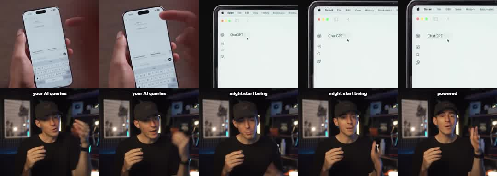

# v16_s55 · split_screenrec · 106.1–108.1s (calidad 3)

- **Guion:** your AI queries might start being powered by
- **Qué se ve:** Arriba móvil en mano con chat y teclado (106,07) y ventana de Safari con «ChatGPT» y cursor (107,07). Subtítulos «your AI queries», «might start being», «powered».
- **Diseño:** Pantalla dividida: evidencia arriba, él abajo en set oscuro (gorra y camiseta negras, tubo de luz cálida a la derecha, luz cian a la izquierda). Costura recta sin borde en y≈639 px de 1280 (49,9 %). Subtítulo: sans bold blanca (tipo Inter/Helvetica Now Bold) ~30 px de alto de fuente sobre 720 px de ancho, 1–3 palabras, centrado en x, sombra negra suave. Subtítulo en y≈680 px (53 %), justo bajo la costura. Arriba: pantalla de dispositivo (móvil en mano con chat, ventana de navegador con cursor).
- **Efectos:** Sin texturas.
- **Animación:** Movimiento de mano/cursor; corte seco.
- **Por qué aquí:** Conecta con el espectador: tu uso diario.
