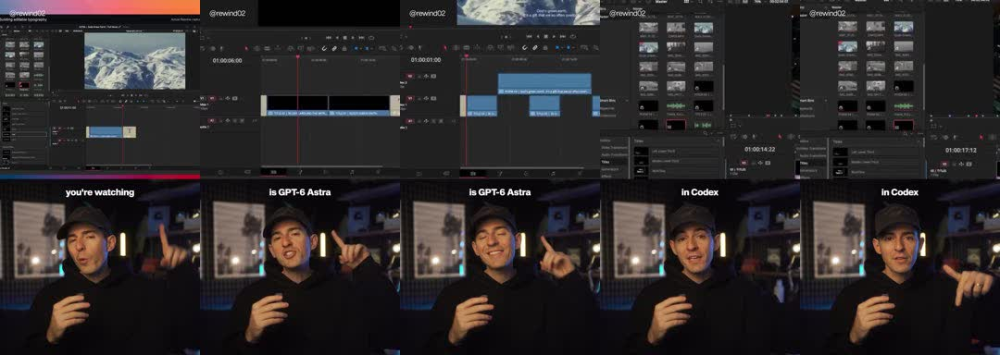

# v17_s06 · split_screenrec · 9.7–12.5s (calidad 5)

- **Guion:** What you're watching is GPT-6 Astra in Codex,
- **Qué se ve:** Split. Arriba, DaVinci Resolve en time-lapse: visor con montaña nevada, timeline que se va llenando de clips (azules, naranja de audio, verdes), media pool. Subtítulos «What / you're watching / is GPT-6 Astra / in Codex».
- **Diseño:** Pantalla dividida (costura en y≈50.3% del alto): arriba grabación de pantalla de la app (UI oscura), abajo él en plano medio con gorra y sudadera negras. Subtítulo pequeño: sans geométrica bold (tipo Aeonik/Satoshi bold), blanco #FFFFFF, minúsculas tipo frase, ≈30 px de cuerpo sobre 720 px de ancho (bloque de 22 px de alto), centrado en X, 1–3 palabras por bloque justo bajo la costura (centro y≈54 %).
- **Efectos:** Grabación con zoom digital; a veces se ve el fondo de escritorio degradado naranja-rosa-azul en los bordes. Sin grano ni viñeta añadidos.
- **Animación:** Entra y sale por corte seco (1 fotograma). Dentro, la grabación va acelerada (time-lapse) con saltos internos y paneos/zoom de cámara virtual; el subtítulo cambia por pop seco.
- **Por qué aquí:** «What you're watching is…»: frase deíctica → la prueba es la propia grabación del agente editando. Describir = mostrar.
