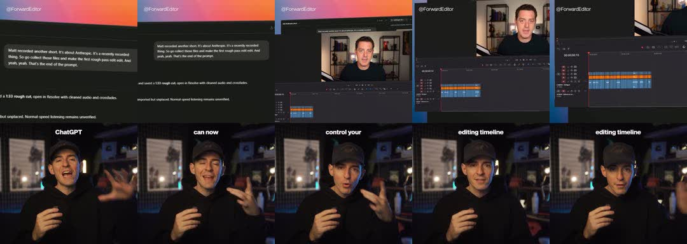

# v17_s09 · split_screenrec · 16.0–18.9s (calidad 3)

- **Guion:** ChatGPT can now control your editing timeline for
- **Qué se ve:** Split. Arriba: texto del chat de Codex («Matt recorded another short. It's about Anthropic… make the first rough pass edit…»), luego Resolve con un hombre hablando a cámara en el visor y un timeline con clips azul/naranja. Subtítulos «ChatGPT / can now / control your / editing timeline».
- **Diseño:** Pantalla dividida (costura en y≈50.3% del alto): arriba grabación de pantalla de la app (UI oscura), abajo él en plano medio con gorra y sudadera negras. Subtítulo pequeño: sans geométrica bold (tipo Aeonik/Satoshi bold), blanco #FFFFFF, minúsculas tipo frase, ≈30 px de cuerpo sobre 720 px de ancho (bloque de 22 px de alto), centrado en X, 1–3 palabras por bloque justo bajo la costura (centro y≈54 %).
- **Efectos:** Grabación con zoom digital; a veces se ve el fondo de escritorio degradado naranja-rosa-azul en los bordes. Sin grano ni viñeta añadidos.
- **Animación:** Entra y sale por corte seco (1 fotograma). Dentro, la grabación va acelerada (time-lapse) con saltos internos y paneos/zoom de cámara virtual; el subtítulo cambia por pop seco.
- **Por qué aquí:** Explica en simple («ChatGPT can now control your editing timeline») y lo prueba con la conversación real + el timeline resultante.
