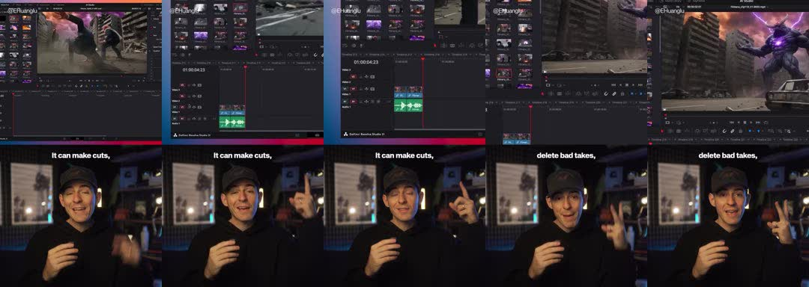

# v17_s11 · split_screenrec · 19.4–21.2s (calidad 3)

- **Guion:** It can make cuts, delete bad takes,
- **Qué se ve:** Split. Arriba Resolve: media pool con miniaturas y timeline con un clip verde de audio; visor con escena urbana gris. Subtítulos «It can make cuts, / delete bad takes,».
- **Diseño:** Pantalla dividida (costura en y≈50.3% del alto): arriba grabación de pantalla de la app (UI oscura), abajo él en plano medio con gorra y sudadera negras. Subtítulo pequeño: sans geométrica bold (tipo Aeonik/Satoshi bold), blanco #FFFFFF, minúsculas tipo frase, ≈30 px de cuerpo sobre 720 px de ancho (bloque de 22 px de alto), centrado en X, 1–3 palabras por bloque justo bajo la costura (centro y≈54 %).
- **Efectos:** Grabación con zoom digital; a veces se ve el fondo de escritorio degradado naranja-rosa-azul en los bordes. Sin grano ni viñeta añadidos.
- **Animación:** Entra y sale por corte seco (1 fotograma). Dentro, la grabación va acelerada (time-lapse) con saltos internos y paneos/zoom de cámara virtual; el subtítulo cambia por pop seco.
- **Por qué aquí:** Empieza la lista de capacidades: cada ítem tendrá su propia prueba visual. Ítems 1–2 (cortes, tomas malas) = timeline.
