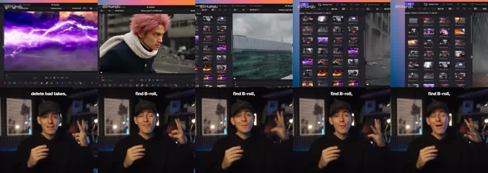

# v17_s12 · split_screenrec · 21.2–22.5s (calidad 3)

- **Guion:** find b-roll,
- **Qué se ve:** Split. Arriba visor de Resolve con b-roll que cambia: rayos púrpura, ráfaga de planos de 1 fotograma (personaje de pelo rosa, calle, robot), hombre agachado en una azotea; luego rejilla del media pool. Subtítulo «find B-roll,».
- **Diseño:** Pantalla dividida (costura en y≈50.3% del alto): arriba grabación de pantalla de la app (UI oscura), abajo él en plano medio con gorra y sudadera negras. Subtítulo pequeño: sans geométrica bold (tipo Aeonik/Satoshi bold), blanco #FFFFFF, minúsculas tipo frase, ≈30 px de cuerpo sobre 720 px de ancho (bloque de 22 px de alto), centrado en X, 1–3 palabras por bloque justo bajo la costura (centro y≈54 %).
- **Efectos:** Grabación con zoom digital; a veces se ve el fondo de escritorio degradado naranja-rosa-azul en los bordes. Sin grano ni viñeta añadidos.
- **Animación:** Entra y sale por corte seco (1 fotograma). Dentro, la grabación va acelerada (time-lapse) con saltos internos y paneos/zoom de cámara virtual; el subtítulo cambia por pop seco.
- **Por qué aquí:** «find b-roll» → se ve b-roll entrando al visor. Ítem 3 de la lista, cambio visual sincronizado a la palabra.
