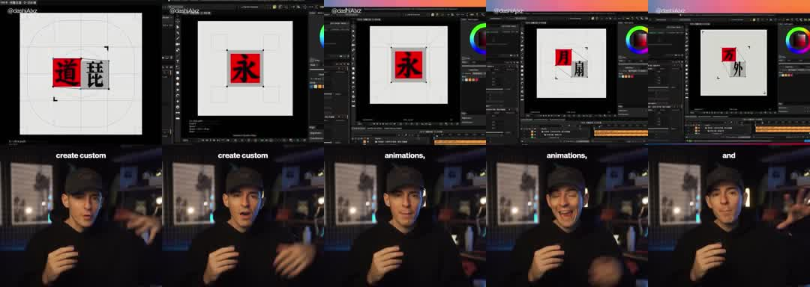

# v17_s14 · split_screenrec · 24.2–26.3s (calidad 3)

- **Guion:** create custom animations and mix
- **Qué se ve:** Split. Arriba, lienzo de animación (tipo After Effects/Fusion): cuadrado gris claro con bloques rojos y caracteres chinos negros (道, 永, 月…) que se transforman; paneles oscuros alrededor y rueda de color. Subtítulos «create custom / animations,».
- **Diseño:** Pantalla dividida (costura en y≈50.3% del alto): arriba grabación de pantalla de la app (UI oscura), abajo él en plano medio con gorra y sudadera negras. Subtítulo pequeño: sans geométrica bold (tipo Aeonik/Satoshi bold), blanco #FFFFFF, minúsculas tipo frase, ≈30 px de cuerpo sobre 720 px de ancho (bloque de 22 px de alto), centrado en X, 1–3 palabras por bloque justo bajo la costura (centro y≈54 %).
- **Efectos:** Grabación con zoom digital; a veces se ve el fondo de escritorio degradado naranja-rosa-azul en los bordes. Sin grano ni viñeta añadidos.
- **Animación:** Entra y sale por corte seco (1 fotograma). Dentro, la grabación va acelerada (time-lapse) con saltos internos y paneos/zoom de cámara virtual; el subtítulo cambia por pop seco.
- **Por qué aquí:** «create custom animations» → animación generándose en el lienzo. Ítem 5.
