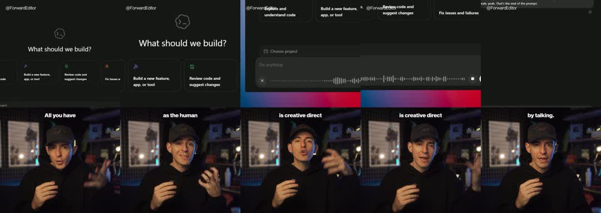

# v17_s17 · split_screenrec · 28.6–32.1s (calidad 5)

- **Guion:** you have to do as the human is creative direct by talking.
- **Qué se ve:** Split. Arriba la app Codex: pantalla «What should we build?» con tarjetas («Build a new feature, app, or tool», «Review code and suggest changes»), luego la caja «Do anything» con una onda de voz grabándose y el selector «GPT-6 Astra Light». Subtítulos «All you have / to do / as the human / is creative direct / by talking.»
- **Diseño:** Pantalla dividida (costura en y≈50.3% del alto): arriba grabación de pantalla de la app (UI oscura), abajo él en plano medio con gorra y sudadera negras. Subtítulo pequeño: sans geométrica bold (tipo Aeonik/Satoshi bold), blanco #FFFFFF, minúsculas tipo frase, ≈30 px de cuerpo sobre 720 px de ancho (bloque de 22 px de alto), centrado en X, 1–3 palabras por bloque justo bajo la costura (centro y≈54 %).
- **Efectos:** Grabación con zoom digital; a veces se ve el fondo de escritorio degradado naranja-rosa-azul en los bordes. Sin grano ni viñeta añadidos.
- **Animación:** Entra y sale por corte seco (1 fotograma). Dentro, la grabación va acelerada (time-lapse) con saltos internos y paneos/zoom de cámara virtual; el subtítulo cambia por pop seco.
- **Por qué aquí:** «creative direct by talking» → se ve la onda de voz dictando el prompt: prueba literal de que solo hay que hablar.
