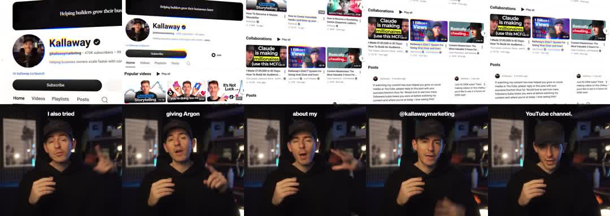

# v06_s25 · split_social · 38.9–42.3s (calidad 4)

- **Guion:** I also tried giving Argonne everything about my Callaway marketing YouTube channel.
- **Qué se ve:** Arriba: su canal de YouTube «Kallaway» (avatar, verificado, botón Subscribe) y scroll rápido por las filas de miniaturas y posts.
- **Diseño:** Interfaz clara de YouTube; nombre «Kallaway» en serif bold. Subtítulo blanco sans bold (tipo Inter), 1–3 palabras, ~30 px sobre 720 (≈2,3 % del alto), centrado, y≈52,7 % (≈58 px bajo la costura, que está en y≈48,1 %); sin caja (el subtítulo muestra «@kallawaymarketing» en vez de las palabras dichas)
- **Efectos:** Set oscuro con luces cian y ámbar desenfocadas; sin textura añadida
- **Animación:** Corte seco de entrada y salida (1 fotograma); scroll escalonado con ~8 micro-saltos
- **Por qué aquí:** «Everything about my YouTube channel» → el canal real (prueba social + autopromoción)
