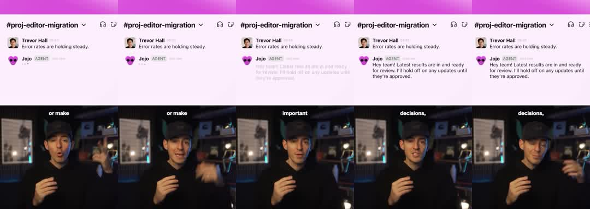

# v10_s23 · split_social · 46.4–47.7s (calidad 4)

- **Guion:** make important decisions, but
- **Qué se ve:** Arriba canal tipo Slack '#proj-editor-migration': Trevor Hall y 'Jojo AGENT' escribiendo, fondo rosa.
- **Diseño:** Split 50/50: captura del canal/post a sangre arriba, macro (texto de la interfaz legible, ≈3–4 líneas visibles). Subtítulo: sans geométrica bold blanca, minúsculas con puntuación, ≈30 px de alto de letra sobre 720 px de ancho, centrado en x, 1–3 palabras, bajo la costura (y≈54 %).
- **Efectos:** Sin grano, papel ni halftone añadidos. A-roll: set oscuro, viñeta natural, prácticos cálidos y tubo/luz cian al fondo. Mitad superior sin filtros: el material conserva su color original (contraste fuerte con el set oscuro de abajo).
- **Animación:** La mitad superior entra por corte seco (1 fotograma) sincronizada con la palabra; los cambios internos también son cortes secos; el único movimiento es el propio del material (cámara del clip, scroll o zoom lento). La mitad inferior no corta (toma continua). Subtítulo por sustitución instantánea cada 1–3 palabras.
- **Por qué aquí:** 'make important decisions': el agente pide aprobación en el canal del equipo.
