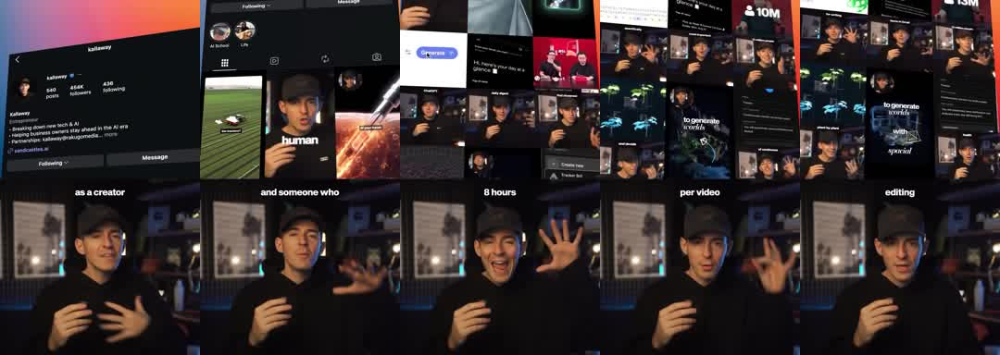

# v17_s18 · split_social · 32.1–35.9s (calidad 4)

- **Guion:** Now, as a creator and someone who used to spend eight hours per video editing,
- **Qué se ve:** Split. Arriba su perfil de Instagram «kallaway» (540 posts, 454K followers, 436 following, bio) en perspectiva; baja a la rejilla y se abre a un mural de reels con contadores (7M, 12M, 13M). Subtítulos «as a creator / and someone who / used to spend / 8 hours / per video / editing».
- **Diseño:** Pantalla dividida (costura en y≈50.3% del alto): arriba captura de red social sobre fondo degradado, abajo él. Subtítulo pequeño: sans geométrica bold (tipo Aeonik/Satoshi bold), blanco #FFFFFF, minúsculas tipo frase, ≈30 px de cuerpo sobre 720 px de ancho (bloque de 22 px de alto), centrado en X, 1–3 palabras por bloque bajo la costura.
- **Efectos:** Captura inclinada en perspectiva 3D con fondo degradado naranja-rosa-azul; sin grano.
- **Animación:** Corte seco de entrada; cámara virtual hace scroll/zoom-out sobre la captura; corte seco de salida.
- **Por qué aquí:** Credencial personal («as a creator… 8 hours per video»): enseña su perfil y sus números para ganar autoridad antes de opinar.
