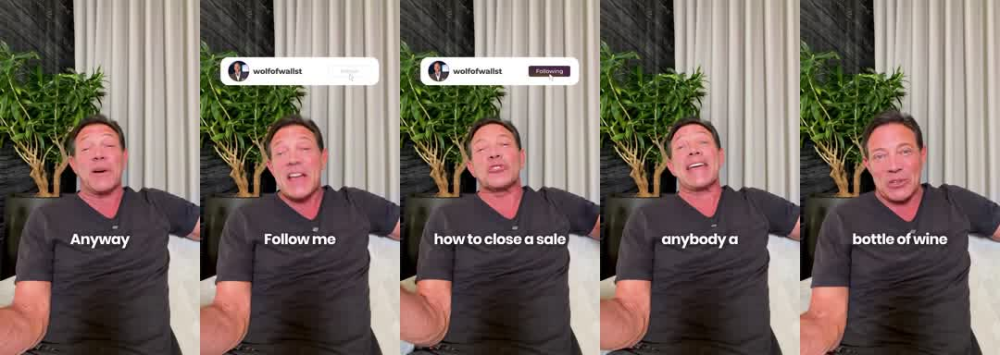

# v01_s14 · 14 Título - cierre - CTA · 51.3–57.6s (calidad 4)

- **Guion:** Anyway, follow me. I'll teach you how to close a sale without buying anybody a bottle of wine.
- **Qué se ve:** Al decir 'follow' aparece arriba una barra de perfil blanca: foto 'wolfofwallst' + botón 'Follow' que con un cursor/clic pasa a 'Following' (degradado rosa-morado → gris oscuro). Subtítulos 'Anyway' / 'Follow me' / 'I'll teach you' / 'how to close a sale' / 'without buying' / 'anybody a' / 'bottle of wine'. (observado 51.6–57.0)
- **Diseño:** Barra blanca redondeada (radio ~ media altura, píldora), centro (50 %, 20 %), ancho ~78 %, alto ~5 %; nombre bold negro pequeño; botón a la derecha: gris claro 'Follow' → degradado rosa/morado 'Following' (52.6–54.6) → negro/gris 'Following' (54.8).
- **Efectos:** Ninguno.
- **Animación:** Barra entra a 52.0 (justo en 'follow' 52.02) con despliegue horizontal desde la izquierda (frame 52.0: barra fina parcial) ~0.1 s; cursor y clic ~52.5–52.7; botón cambia de color; sale seco ~55.2. Dura ~3.2 s.
- **Por qué aquí:** CTA literal: se muestra el acto de seguir; la promesa final enlaza la anécdota con su producto (vender sin gastar) (inferido).
