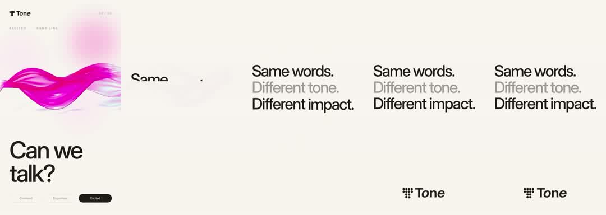

# v02_s05 · 14 Título - cierre - CTA · 13.0–18.9s (calidad 1)

- **Guion:** (sin voz)
- **Qué se ve:** Cierre: fondo crema; 'Same words.' (negro) / 'Different tone.' (gris) / 'Different impact.' (negro) a la izquierda; a 16.4–17.0 el logo '⁞ Tone' se forma con partículas de puntos abajo-centro. (observado 14.4–18.6)
- **Diseño:** Sans grotesca medium ~4 % del alto, 3 líneas a la izquierda y ~33–43 %; logo negro con 'Tone' itálica bold, centro (50 %, ~90 % del alto), ancho ~18 %.
- **Efectos:** Partículas de puntos que se agrupan en el logo.
- **Animación:** Cada línea sube por máscara escalonada (14.4, 15.0, 15.6; ~0.2 s). Logo: partículas dispersas convergen 16.4–17.0.
- **Por qué aquí:** Remate del claim y firma de marca (inferido). FUERA DE ESTILO.
