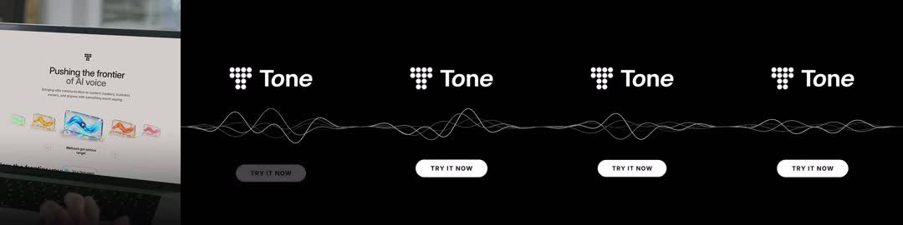

# v03_s21 · 14 Título - cierre - CTA · 49.2–53.0s (calidad 2)

- **Guion:** (sin voz)
- **Qué se ve:** Cierre negro: logo '⁞ Tone' blanco, onda sinusoidal de líneas blancas animada, botón píldora 'TRY IT NOW' blanco. (observado 49.5–52.5)
- **Diseño:** Logo blanco ~22 % del ancho a y ~36 %; onda a lo ancho a y ~57 %; botón píldora blanco texto negro mayúsculas pequeñas a y ~77 %.
- **Efectos:** Ninguno.
- **Animación:** Corte 49.42; logo y botón entran con fade (49.5–50.0, botón gris→blanco); onda en loop.
- **Por qué aquí:** CTA de producto (inferido).
