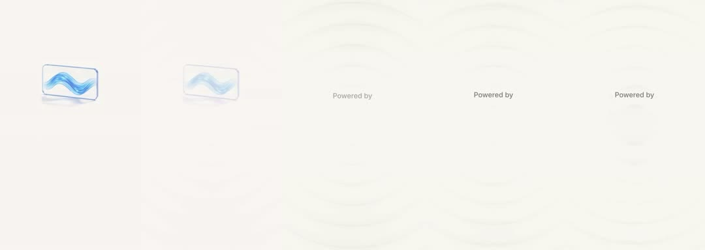

# v04_s09 · 14 Título - cierre - CTA · 30.8–31.8s (calidad 1)

- **Guion:** Powered by tone.
- **Qué se ve:** Ondas concéntricas, 'Powered by / Tone' grande y píldora negra '@hellotoneai'; termina en negro (34.53). (observado 31.33–34.5)
- **Diseño:** 'Tone' bold ~10 % del alto centrado a ~50 %; píldora negra texto blanco a ~60 %.
- **Efectos:** Anillos concéntricos tenues.
- **Animación:** 'Powered by' aparece 31.3, logo y handle 31.5; corte a negro 34.53; audio en silencio desde 33.0 (derivado).
- **Por qué aquí:** Firma y handle (inferido). FUERA DE ESTILO.
