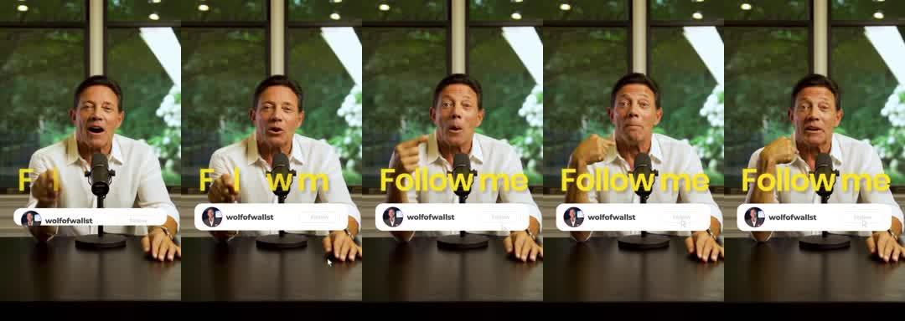

# v05_s20 · 14 Título - cierre - CTA · 52.2–53.2s (calidad 4)

- **Guion:** follow me.
- **Qué se ve:** 'Follow me' AMARILLO grande y debajo barra de perfil blanca 'wolfofwallst' con botón Follow que pasa a 'Following' (degradado rosa-morado). (observado 52.2–53.4)
- **Diseño:** 'Follow me' amarillo ~6 % del alto a ~55 %, ancho ~85 %; barra blanca píldora ~78 % del ancho a ~67 % del alto (bajo el subtítulo, no arriba).
- **Efectos:** Ninguno.
- **Animación:** Corte 52.14; 'Follow me' write-on por letras (52.2–52.6); barra entra 52.2; cursor clic → 'Following' a ~53.4; fin 53.59.
- **Por qué aquí:** CTA literal (inferido).
