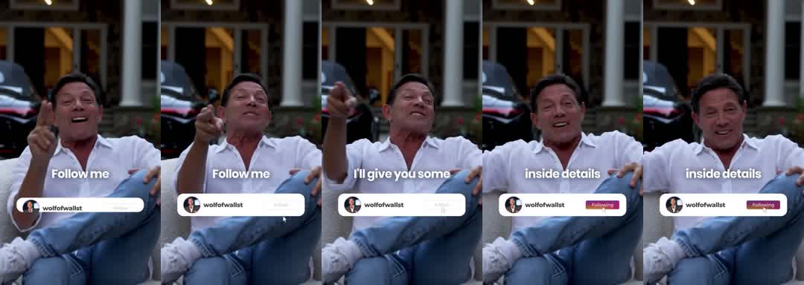

# v06_s17 · 14 Título - cierre - CTA · 58.8–60.6s (calidad 4)

- **Guion:** follow me, I'll give you some inside details.
- **Qué se ve:** 'follow me, I'll give you some inside details.' Él señala a cámara; aparece tarjeta de perfil IG 'wolfofwallst' con botón 'Follow' y un cursor que hace clic; el botón pasa a 'Following' morado-magenta.
- **Diseño:** Subtítulo blanco Poppins-like bold centrado a ~61 % del alto; sin palabra destacada ni amarillo. Tarjeta blanca redondeada tipo píldora con avatar circular, nombre en negro bold y botón; botón tras clic con degradado morado→magenta (#7A2A8A→#C2286E aprox.).
- **Efectos:** Sin texturas añadidas; grade natural cálido de atardecer (fondo #090705/#302F2E, piel cálida, camisa blanca ligeramente azulada #AAB2D1); fondo desenfocado por profundidad de campo (casa con columnas blancas, coche negro).
- **Animación:** Jump cut 58.82; la tarjeta entra 58.82 como barra fina que se expande verticalmente (≈2 frames); cursor entra desde abajo-derecha 59.0–59.2, clic ≈60.0 → 'Following'. Llega al final del video.
- **Por qué aquí:** CTA literal: 'follow me' + simulación del gesto de seguir (instrucción visual).
