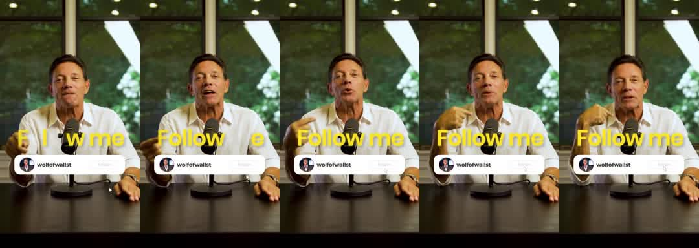

# v07_s25 · 14 Título - cierre - CTA · 51.8–52.4s (calidad 4)

- **Guion:** follow me.
- **Qué se ve:** 'follow me.' — 'Follow me' amarillo grande revelado letra a letra + tarjeta de perfil 'wolfofwallst' con botón Follow y cursor.
- **Diseño:** Fondo de estudio: mesa negra brillante, micrófono de podcast negro en primer plano centrado, ventanal con columnas y vegetación verde desenfocada detrás (no croma). Subtítulos centrados sobre el pecho/micrófono. Tarjeta blanca píldora bajo el texto.
- **Efectos:** Grade cálido-verdoso natural, piel cálida, negros profundos en la mesa; bajo el A-roll queda a veces una franja negra inferior (≈5–9 % del alto) cuando el plano está más abierto (observed 3.7, 37.5); sin grano ni viñeta añadida.
- **Animación:** Letras de 'Follow me' aparecen en orden aleatorio 51.57→51.9; tarjeta aparece 51.57; cursor entra abajo-derecha ≈51.77; el video termina 52.68 sin clic visible.
- **Por qué aquí:** CTA literal y visual.
