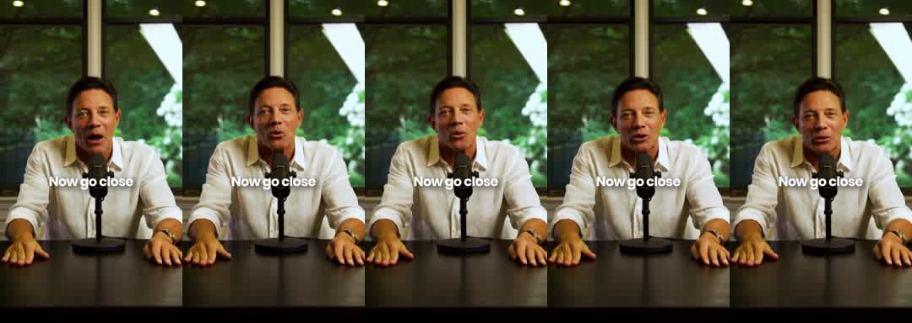

# v09_s26 · 14 Título - cierre - CTA · 63.0–63.7s (calidad 3)

- **Guion:** Now go close.
- **Qué se ve:** 'Now go close.' — cierre sin tarjeta follow.
- **Diseño:** Estudio: mesa negra brillante, micrófono de podcast centrado, ventanal con vegetación detrás (no croma). Subtítulos centrados sobre el pecho.
- **Efectos:** Grade cálido-verdoso natural; franja negra inferior en algunos encuadres; sin grano ni viñeta añadida.
- **Animación:** Corte 62.69; termina en 64.22.
- **Por qué aquí:** Orden final (CTA de acción, no de seguir).
