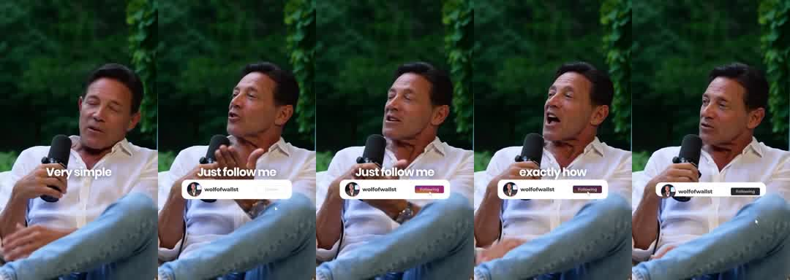

# v11_s22 · 14 Título - cierre - CTA · 40.1–44.1s (calidad 4)

- **Guion:** Very simple, just follow me and I'll show you exactly how to do this.
- **Qué se ve:** [observado 40.5–43.9] Jordan; aparece una tarjeta blanca de perfil (avatar + 'wolfofwallst' + botón) bajo el caption; un cursor pulsa el botón que pasa a 'Following' rosa-morado.
- **Diseño:** Tarjeta blanca #FFFFFF, esquinas redondeadas (~12 px a 720 de ancho, inferido), ~70 % del ancho, centro x≈50 %, y≈67 %, alto ~5 %. Botón a la derecha: gris claro → degradado rosa/morado 'Following'. Caption blanco encima a y≈61 %.
- **Efectos:** Sombra muy suave bajo la tarjeta (inferido).
- **Animación:** [observado 40.77] la tarjeta entra en 1–2 fr (expande/aparece); cursor blanco aparece ~40.97, botón cambia a 'Following' a ~41.97 (entre 'me' y 'and').
- **Por qué aquí:** [inferido] CTA literal: mostrar el gesto de seguir reduce fricción.
