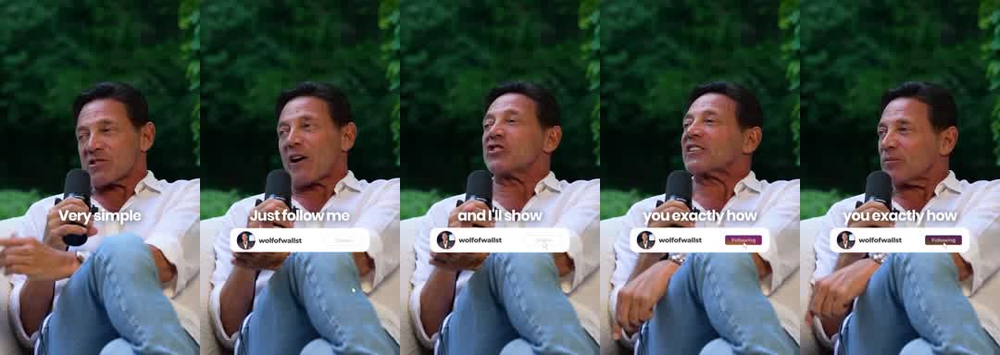

# v13_s26 · 14 Título - cierre - CTA · 39.8–42.8s (calidad 4)

- **Guion:** Very simple. Just follow me and I'll show you exactly how.
- **Qué se ve:** [observado 40.4–42.5] Jordan; tarjeta blanca de perfil 'wolfofwallst' bajo el caption; botón pasa a 'Following' rosa/morado.
- **Diseño:** Tarjeta blanca redondeada ~70 % ancho, y≈67 %, igual a v11.
- **Efectos:** Ninguno.
- **Animación:** [observado 40.43] tarjeta aparece en 1–2 fr con 'follow'; [observado 41.57] botón → 'Following'.
- **Por qué aquí:** [inferido] CTA literal, plantilla de la serie.
