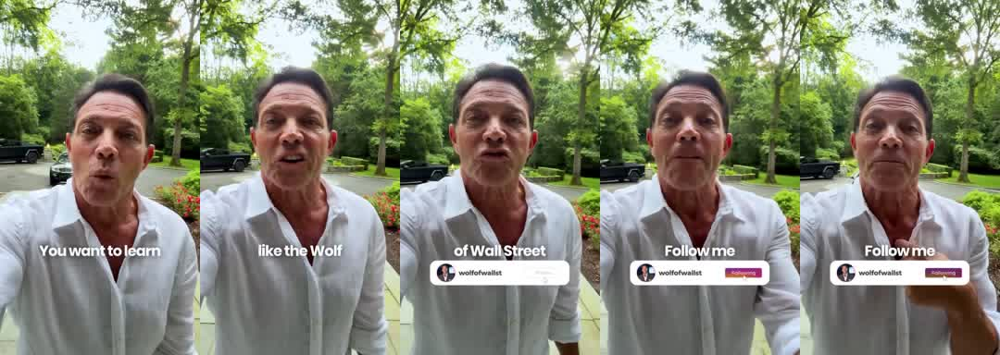

# v15_s23 · 14 Título - cierre - CTA · 49.0–52.1s (calidad 3)

- **Guion:** You wanna learn to sell like the Wolf of Wall Street? Follow me.
- **Qué se ve:** [observado 49.0–52.0] 'You want to learn' / 'like the Wolf' / 'of Wall Street' / 'Follow me'; bajo el caption aparece la tarjeta blanca de perfil 'wolfofwallst' y el botón pasa a 'Following' rosa/morado. Selfie con celular en exterior (entrada de una casa con árboles, coches negros aparcados); Jordan con camisa blanca de lino, brazo extendido sujetando el teléfono, plano medio-corto con gran angular.
- **Diseño:** Subtítulo: 1 línea blanca extra-bold tipo Poppins, minúsculas, ~3 % alto, ~40–70 % ancho, centro y≈70 % (pecho bajo), sombra suave; sin amarillo; cambio seco por bloque. Tarjeta blanca redondeada ~70 % ancho, centro x≈50 %, y≈77 %, alto ~4 %.
- **Efectos:** Grado natural del móvil, cielo casi quemado, verdes; sin textura ni viñeta añadida.
- **Animación:** [observado ~50.0] tarjeta aparece en 1–2 fr en 'of Wall Street'; [observado ~51.1] botón → 'Following' con cursor; [observado 49.03] jump-cut.
- **Por qué aquí:** [inferido] CTA con la marca personal ('Wolf of Wall Street') y gesto de seguir mostrado.
