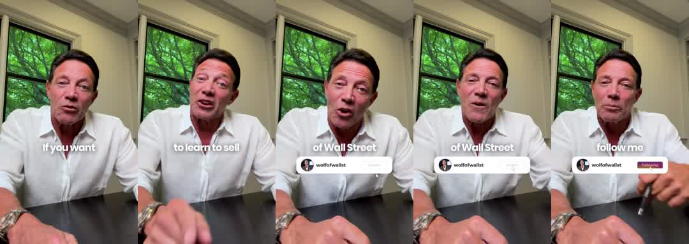

# v16_s14 · 14 Título - cierre - CTA · 39.9–42.6s (calidad 4)

- **Guion:** If you want one to sell like the Wolf of Wall Street, follow me.
- **Qué se ve:** [observed 40.87–fin] A-roll + tarjeta de perfil animada (avatar, 'wolfofwallst', botón Follow) bajo el subtítulo; un cursor pulsa y el botón pasa a 'Following' morado (~41.9–42.0).
- **Diseño:** Pastilla blanca redondeada (radio grande ≈ alto/2) x 15–85 %, y 64–71 % (≈70 % ancho); avatar circular izquierda, handle negro bold, botón morado #7B2D7A aprox. a la derecha.
- **Efectos:** Sombra muy leve de la tarjeta.
- **Animación:** [observed] Entra en 40.87 (con 'Wolf' 40.84) con escala/slide rápido ≈0.15 s; cursor click ≈41.95 cuando dice 'follow' (41.84).
- **Por qué aquí:** [inferred] CTA demostrativo: enseña literalmente el gesto de seguir.
