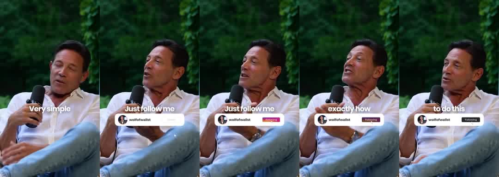

# v17_s20 · 14 Título - cierre - CTA · 40.1–43.8s (calidad 4)

- **Guion:** Very simple, just follow me and I'll show you exactly how to do this.
- **Qué se ve:** [observed 40.77–fin] Jordan; tarjeta de perfil 'wolfofwallst' bajo el subtítulo; botón pasa a 'Following' morado ≈41.9.
- **Diseño:** Pastilla blanca x15–85 %, y64–71 %, avatar circular, botón morado/rosa degradado.
- **Efectos:** Ninguno.
- **Animación:** [observed] Tarjeta entra 40.77 (antes de 'just' 41.04); click a Following ≈41.9 tras 'follow' (41.20).
- **Por qué aquí:** [inferred] CTA demostrativo.
