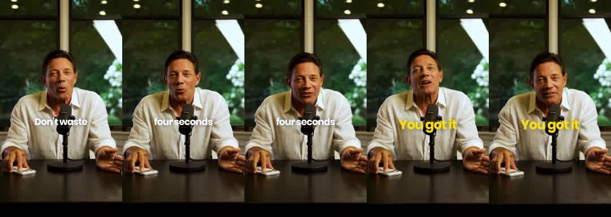

# v18_s21 · 14 Título - cierre - CTA · 52.0–54.0s (calidad 3)

- **Guion:** Don't waste four seconds. You got it.
- **Qué se ve:** [observed 51.9–54.0] Cierre en A-roll: 'Don't waste', 'four seconds', 'You got it' amarillo. Sin tarjeta de follow.
- **Diseño:** Amarillo una línea en 'You got it'.
- **Efectos:** Igual.
- **Animación:** Reemplazo duro.
- **Por qué aquí:** [inferred] Cierre-mantra que repite el dato '4 seconds'; sin CTA de seguir.
