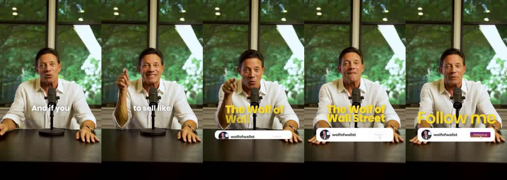

# v20_s23 · 14 Título - cierre - CTA · 58.7–62.2s (calidad 4)

- **Guion:** If you want to learn to sell like the Wolf of Wall Street, follow me.
- **Qué se ve:** [observed 58.73–fin] Jump cut 58.73; 'want to learn', 'to sell like', 'The Wolf of / Wall Street' amarillo grande en 2 líneas, tarjeta de perfil (60.4) y 'Follow me' amarillo gigante (61.4–61.9) + 'Following'.
- **Diseño:** 'Follow me' amarillo ≈7 % alto ≈80 % ancho; tarjeta pastilla blanca x12–88 %, y≈72–78 %.
- **Efectos:** Ninguno.
- **Animación:** [observed] 'The Wolf of Wall Street' write-on 60.15–60.4; tarjeta entra 60.4; 'Follow me' write-on por letras 61.4→61.9; click a 'Following' ≈61.65.
- **Por qué aquí:** [inferred] CTA con la marca 'Wolf of Wall Street' en amarillo.
