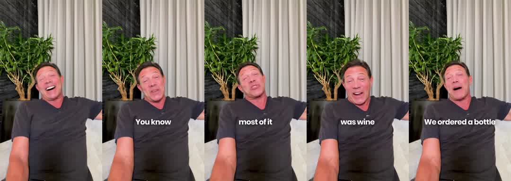

# v01_s02 · aroll_caption · 4.3–7.7s (calidad 3)

- **Guion:** Ah, yeah, but y 'all, most of it thought was wine. We ordered a bottle of
- **Qué se ve:** Jump cut: deja el teléfono, se ríe echado hacia atrás (4.1–4.5 sin subtítulo durante la risa), luego 'You know' / 'was wine' / 'We ordered a bottle'. (observado 4.1–7.7)
- **Diseño:** Igual sistema: blanco bold geométrica centrada a ~67 % del alto; 'We ordered a bottle' llega a ~55 % del ancho.
- **Efectos:** Ninguno añadido.
- **Animación:** Corte seco en 4.10 (jump cut dentro de la misma toma, en silencio −38 dB). Subtítulo ausente durante la risa 4.1–~4.5 (observado). Bloques secos.
- **Por qué aquí:** Reacción humana (risa) tras el hook: confirma con humor antes de contar la historia (inferido).
