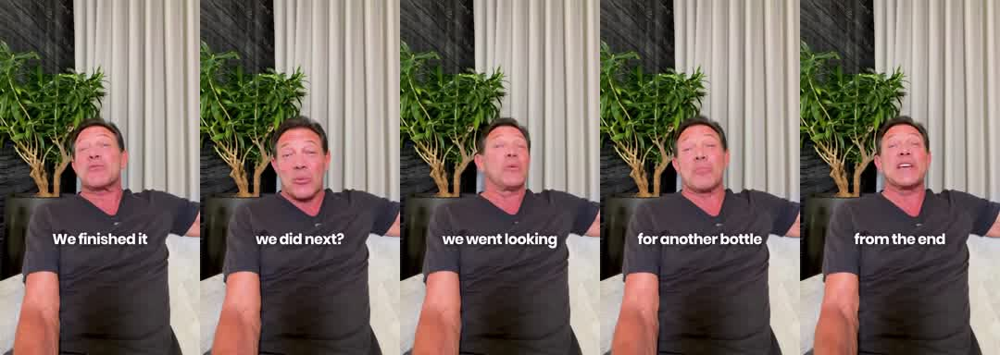

# v01_s05 · aroll_caption · 11.6–15.9s (calidad 3)

- **Guion:** We finished it. You know what we did next? Well, we went looking for another bottle. This one from the end
- **Qué se ve:** A-roll tras jump cut (11.57); subtítulos 'We finished it' / 'we did next?' / 'for another bottle' / 'from the end'. (observado 11.6–15.8)
- **Diseño:** Sistema base: blanco bold geométrica centrada a ~67 % del alto.
- **Efectos:** Ninguno.
- **Animación:** Jump cut seco a 11.57 en la pausa tras 'ended.'; bloques de subtítulo secos cada ~0.6–0.9 s (cambios detectados 12.4, 12.7, 13.43, 13.67, 14.2, 15.07, 15.37).
- **Por qué aquí:** Narración del cuento con cara: tensión cómica ('¿sabes qué hicimos después?') sin distraer (inferido).
