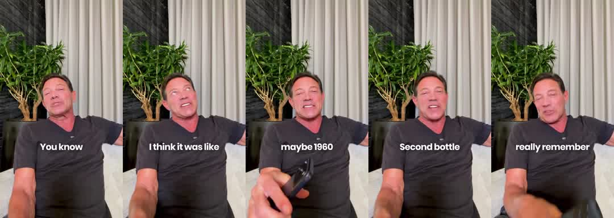

# v01_s07 · aroll_caption · 17.7–23.6s (calidad 2)

- **Guion:** You know, don't ask me for the year. I think it was like maybe in 1916. I don't know what happened. Second bottle. I don't really remember.
- **Qué se ve:** A-roll tras jump cut; él gesticula con un mando/objeto oscuro que acerca a cámara (18.0, 22.5). Subtítulos 'You know' / 'me for the' / 'maybe 1960' / 'on that second bottle' / 'really remember'. (observado 17.65–22.5)
- **Diseño:** Sistema base; 'on that second bottle' llega a ~85 % del ancho.
- **Efectos:** Ninguno.
- **Animación:** Jump cut 17.63; bloques secos (cambios 18.97, 19.47, 20.93, 21.63, 21.93, 22.63, 22.93).
- **Por qué aquí:** Auto-burla del exceso (no recuerda el año ni la botella): humor que humaniza (inferido).
