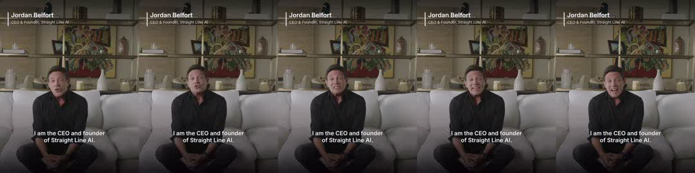

# v03_s03 · aroll_caption · 7.4–8.8s (calidad 2)

- **Guion:** Straight Line AI.
- **Qué se ve:** Corte (7.42) a plano medio frontal en sofá blanco con estantería de arte detrás; arriba-izquierda rótulo 'Jordan Belfort / CEO & Founder, Straight Line AI' con barra vertical blanca. (observado 7.5–8.8)
- **Diseño:** Rótulo: nombre sans medium blanca ~2.5 % del alto, cargo ~1.3 % gris claro, barra vertical fina a la izquierda; posición x ~3 %, y ~2–7 %.
- **Efectos:** Grado cálido-neutro desaturado.
- **Animación:** Corte seco 7.42; rótulo presente desde el corte, sigue visible hasta 9.6 sobre el gráfico siguiente.
- **Por qué aquí:** Lower-third de autoridad al decir el cargo (inferido).
