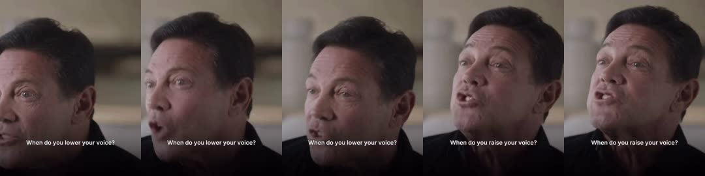

# v03_s08 · aroll_caption · 20.6–22.4s (calidad 2)

- **Guion:** When do you lower your voice? When do you raise
- **Qué se ve:** Primer plano 3/4 (20.52). (observado 21.0)
- **Diseño:** Subtítulo blanco pequeño ~81 %.
- **Efectos:** Grado cinematográfico.
- **Animación:** Corte seco 20.52.
- **Por qué aquí:** Pregunta retórica con cara (inferido).
