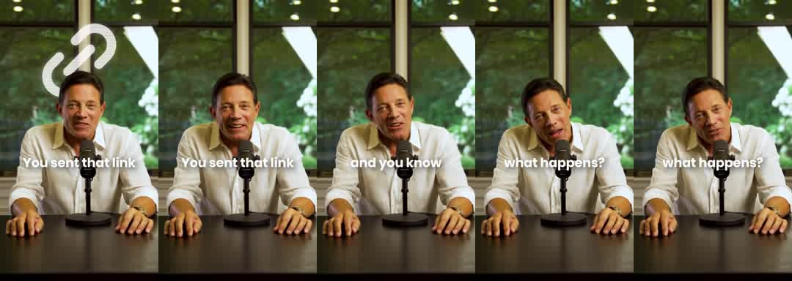

# v05_s02 · aroll_caption · 3.2–4.8s (calidad 3)

- **Guion:** You send that link and you know what happens?
- **Qué se ve:** A-roll; 'You sent that link' / 'and you know' / 'what happens?'. (observado 3.0–4.9)
- **Diseño:** Sistema base Look B (blanco bold a ~55 %).
- **Efectos:** Ninguno añadido.
- **Animación:** Bloques secos.
- **Por qué aquí:** Pregunta que crea curiosidad antes del remate (inferido).
