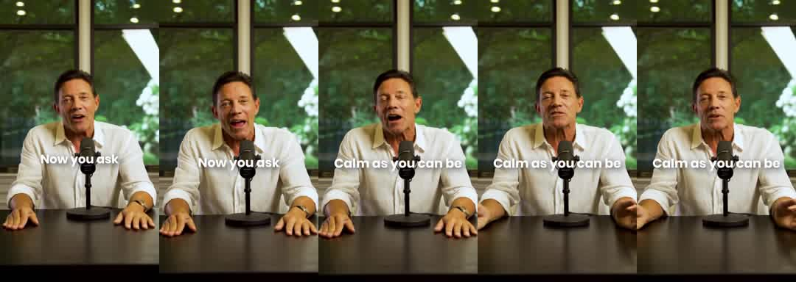

# v05_s11 · aroll_caption · 25.8–27.6s (calidad 3)

- **Guion:** Now you ask. Commas can be.
- **Qué se ve:** A-roll; 'Now you ask' / 'Calm as you can be'. (observado 25.5–27.6)
- **Diseño:** Sistema base; el subtítulo corrige la transcripción ('Calm as you can be').
- **Efectos:** Ninguno.
- **Animación:** Corte seco 25.73.
- **Por qué aquí:** Paso de acción con cara (inferido).
