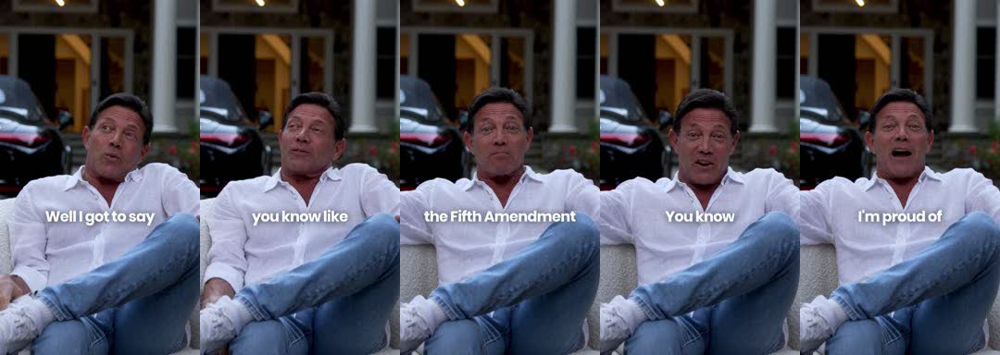

# v06_s02 · aroll_caption · 8.0–14.2s (calidad 3)

- **Guion:** Well, I gotta say, you know, like I gotta kind of take the fifth amendment on this one here, you know? Sorry, that's something I'm proud of.
- **Qué se ve:** Jump cut: deja el móvil, gira hacia cámara con risa y empieza la respuesta ('Well, I gotta say… take the fifth amendment').
- **Diseño:** Subtítulo blanco Poppins-like bold centrado a ~61 % del alto; sin palabra destacada ni amarillo.
- **Efectos:** Sin texturas añadidas; grade natural cálido de atardecer (fondo #090705/#302F2E, piel cálida, camisa blanca ligeramente azulada #AAB2D1); fondo desenfocado por profundidad de campo (casa con columnas blancas, coche negro).
- **Animación:** Corte seco (jump cut) en 8.03 s; caption por frases ('you know like', 'the Fifth Amendment').
- **Por qué aquí:** Cambio de pregunta→respuesta: el corte quita la tarjeta y le da la cara; humor ('quinta enmienda') antes de contar.
