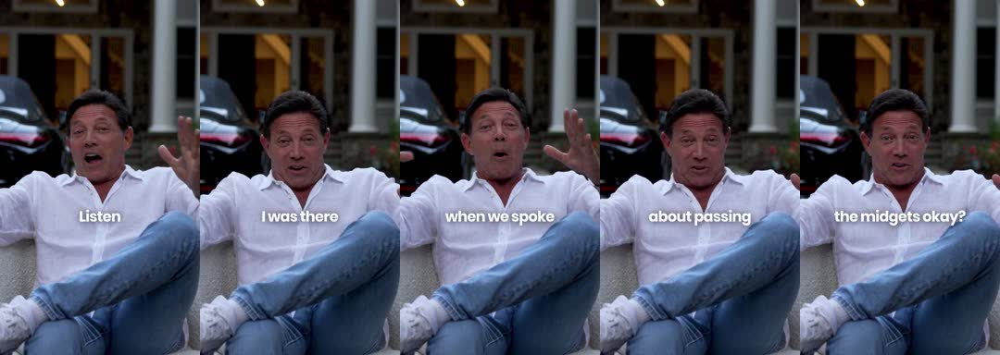

# v06_s03 · aroll_caption · 14.4–18.5s (calidad 2)

- **Guion:** Listen, I was there when we spoke about forcing the midgets, okay?
- **Qué se ve:** 'Listen, I was there when we spoke about forcing the midgets, okay?' — gesticula con ambas manos.
- **Diseño:** Subtítulo blanco Poppins-like bold centrado a ~61 % del alto; sin palabra destacada ni amarillo.
- **Efectos:** Sin texturas añadidas; grade natural cálido de atardecer (fondo #090705/#302F2E, piel cálida, camisa blanca ligeramente azulada #AAB2D1); fondo desenfocado por profundidad de campo (casa con columnas blancas, coche negro).
- **Animación:** Jump cut en 14.60 (entre 'Listen' e 'I'); caption cambia por frase.
- **Por qué aquí:** Entra la historia: él como testigo, cara y gesto venden credibilidad.
