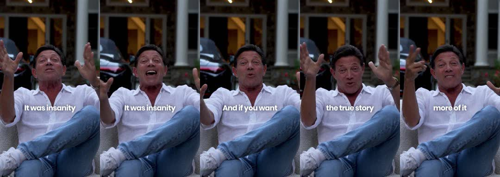

# v06_s16 · aroll_caption · 54.7–58.8s (calidad 2)

- **Guion:** It was insanity, right? And if you wanna know the true story more of it,
- **Qué se ve:** 'It was insanity, right? And if you wanna know the true story more of it,'
- **Diseño:** Subtítulo blanco Poppins-like bold centrado a ~61 % del alto; sin palabra destacada ni amarillo.
- **Efectos:** Sin texturas añadidas; grade natural cálido de atardecer (fondo #090705/#302F2E, piel cálida, camisa blanca ligeramente azulada #AAB2D1); fondo desenfocado por profundidad de campo (casa con columnas blancas, coche negro).
- **Animación:** Jump cut en 54.70 en 'It'.
- **Por qué aquí:** Cierre emocional de la historia y puente al CTA.
