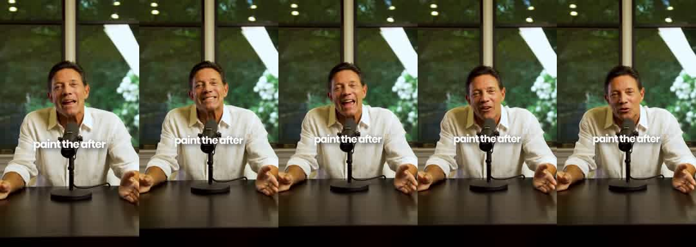

# v07_s18 · aroll_caption · 37.5–38.7s (calidad 3)

- **Guion:** Paint the after.
- **Qué se ve:** Vuelve al A-roll abierto: 'Paint the after.'
- **Diseño:** Fondo de estudio: mesa negra brillante, micrófono de podcast negro en primer plano centrado, ventanal con columnas y vegetación verde desenfocada detrás (no croma). Subtítulos centrados sobre el pecho/micrófono.
- **Efectos:** Grade cálido-verdoso natural, piel cálida, negros profundos en la mesa; bajo el A-roll queda a veces una franja negra inferior (≈5–9 % del alto) cuando el plano está más abierto (observed 3.7, 37.5); sin grano ni viñeta añadida. Franja negra inferior.
- **Animación:** Corte seco 37.54.
- **Por qué aquí:** Regla nueva → cara.
