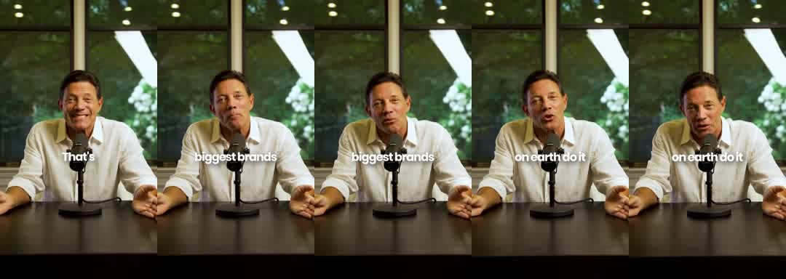

# v07_s22 · aroll_caption · 44.9–47.1s (calidad 3)

- **Guion:** That's how the biggest brands on earth do it
- **Qué se ve:** Vuelve al A-roll: 'That's how the biggest brands on earth do it'
- **Diseño:** Fondo de estudio: mesa negra brillante, micrófono de podcast negro en primer plano centrado, ventanal con columnas y vegetación verde desenfocada detrás (no croma). Subtítulos centrados sobre el pecho/micrófono.
- **Efectos:** Grade cálido-verdoso natural, piel cálida, negros profundos en la mesa; bajo el A-roll queda a veces una franja negra inferior (≈5–9 % del alto) cuando el plano está más abierto (observed 3.7, 37.5); sin grano ni viñeta añadida.
- **Animación:** Corte 44.79 (1 frame con letras residuales 'Dor' abajo-centro).
- **Por qué aquí:** Conclusión en cara.
