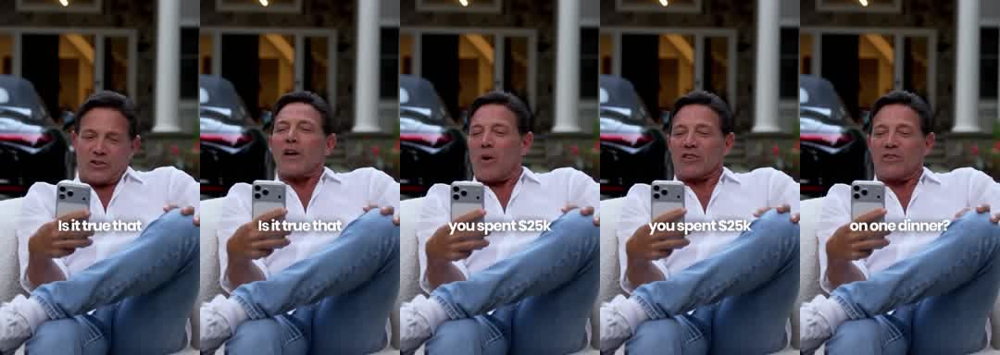

# v08_s01 · aroll_caption · 0.0–3.9s (calidad 4)

- **Guion:** Is it true that you spend $25 ,000 on one dinner?
- **Qué se ve:** Él lee en el móvil la pregunta y la dice en voz alta: 'Is it true that / you spent $25k / on one dinner?'. NO hay tarjeta de comentario en pantalla.
- **Diseño:** Mismo set que v06: sentado en sofá blanco exterior, camisa blanca y vaqueros, casa con columnas y coche negro desenfocados detrás. Subtítulo blanco centrado y≈63 %, sin amarillo.
- **Efectos:** Sin texturas; grade natural de atardecer (#0A0705/#302F2E, camisa blanca-azulada); fotos insertadas planas sin borde ni sombra.
- **Animación:** Sin cortes hasta 4.10; subtítulo por frase.
- **Por qué aquí:** Hook-pregunta con cifra escandalosa ($25k una cena); el móvil sugiere que responde a un seguidor.
