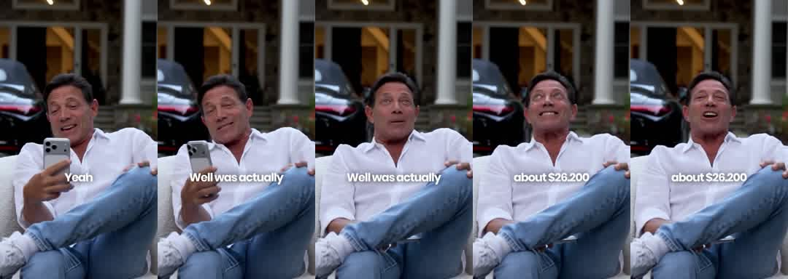

# v08_s02 · aroll_caption · 4.3–8.5s (calidad 4)

- **Guion:** Yeah, well, it's actually about $26 ,200.
- **Qué se ve:** 'Yeah, well, it's actually about $26,200.' — risa, mira a cámara; '$26.200' se mantiene ~3 s.
- **Diseño:** Mismo set que v06: sentado en sofá blanco exterior, camisa blanca y vaqueros, casa con columnas y coche negro desenfocados detrás. Subtítulo blanco centrado y≈63 %, sin amarillo.
- **Efectos:** Sin texturas; grade natural de atardecer (#0A0705/#302F2E, camisa blanca-azulada); fotos insertadas planas sin borde ni sombra.
- **Animación:** Jump cut 4.10 (antes de 'Yeah').
- **Por qué aquí:** Remate: corrige al alza la cifra (presume) → el subtítulo con la cifra se sostiene largo para que se lea.
