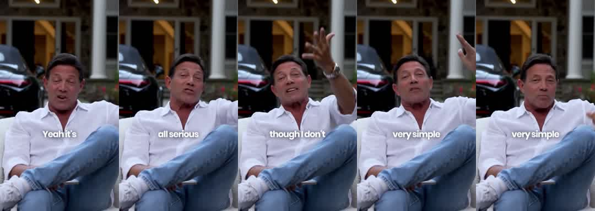

# v08_s10 · aroll_caption · 27.9–29.8s (calidad 2)

- **Guion:** And all seriously though, how did I do it very simple?
- **Qué se ve:** 'And all seriously though, how did I do it very simple?'
- **Diseño:** Mismo set que v06: sentado en sofá blanco exterior, camisa blanca y vaqueros, casa con columnas y coche negro desenfocados detrás. Subtítulo blanco centrado y≈63 %, sin amarillo.
- **Efectos:** Sin texturas; grade natural de atardecer (#0A0705/#302F2E, camisa blanca-azulada); fotos insertadas planas sin borde ni sombra.
- **Animación:** Jump cut 28.10.
- **Por qué aquí:** Transición a la lista de la cena.
