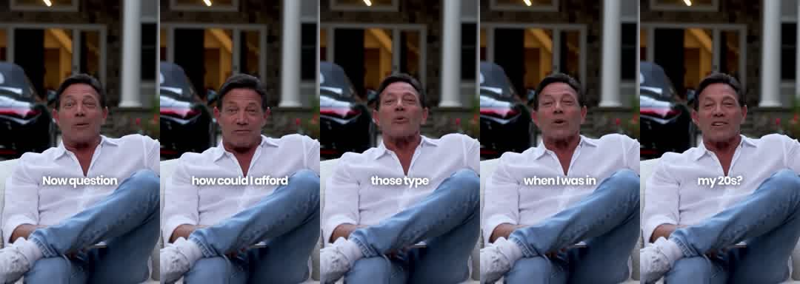

# v08_s19 · aroll_caption · 51.1–55.5s (calidad 3)

- **Guion:** Now, question, how could I afford those type of dinners when I was in my 20s?
- **Qué se ve:** 'Now, question, how could I afford those type of dinners when I was in my 20s?'
- **Diseño:** Mismo set que v06: sentado en sofá blanco exterior, camisa blanca y vaqueros, casa con columnas y coche negro desenfocados detrás. Subtítulo blanco centrado y≈63 %, sin amarillo.
- **Efectos:** Sin texturas; grade natural de atardecer (#0A0705/#302F2E, camisa blanca-azulada); fotos insertadas planas sin borde ni sombra.
- **Animación:** Sin cortes (plano largo 47.33–56.90).
- **Por qué aquí:** Pregunta-pivote: de la anécdota a la lección.
