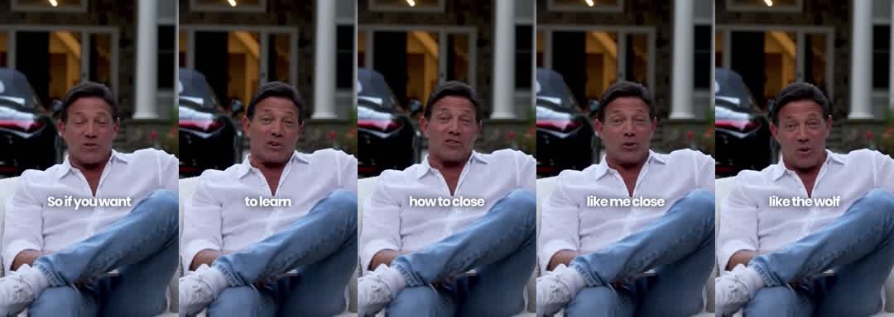

# v08_s24 · aroll_caption · 61.8–64.5s (calidad 2)

- **Guion:** So if you want to learn how to close like me, close like the wolf,
- **Qué se ve:** 'So if you want to learn how to close like me, close like the wolf,'
- **Diseño:** Mismo set que v06: sentado en sofá blanco exterior, camisa blanca y vaqueros, casa con columnas y coche negro desenfocados detrás. Subtítulo blanco centrado y≈63 %, sin amarillo.
- **Efectos:** Sin texturas; grade natural de atardecer (#0A0705/#302F2E, camisa blanca-azulada); fotos insertadas planas sin borde ni sombra.
- **Animación:** Sin cortes hasta 64.69.
- **Por qué aquí:** Setup del CTA.
