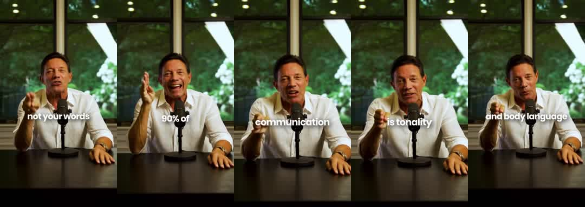

# v09_s15 · aroll_caption · 26.9–31.7s (calidad 3)

- **Guion:** not your words. 90 % of communication is tonality and body language.
- **Qué se ve:** 'not your words. 90% of communication is tonality and body language.'
- **Diseño:** Estudio: mesa negra brillante, micrófono de podcast centrado, ventanal con vegetación detrás (no croma). Subtítulos centrados sobre el pecho.
- **Efectos:** Grade cálido-verdoso natural; franja negra inferior en algunos encuadres; sin grano ni viñeta añadida.
- **Animación:** Corte 26.90; punches 28.03 y 30.70.
- **Por qué aquí:** Dato (90 %) dicho en cara; sin gráfico ni amarillo.
