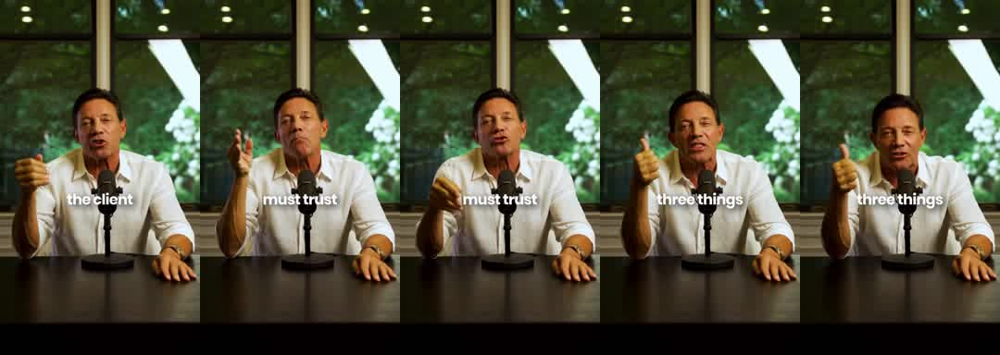

# v09_s20 · aroll_caption · 43.4–45.5s (calidad 3)

- **Guion:** The client must trust three things,
- **Qué se ve:** 'The client must trust three things,' — levanta el pulgar.
- **Diseño:** Estudio: mesa negra brillante, micrófono de podcast centrado, ventanal con vegetación detrás (no croma). Subtítulos centrados sobre el pecho.
- **Efectos:** Grade cálido-verdoso natural; franja negra inferior en algunos encuadres; sin grano ni viñeta añadida.
- **Animación:** Corte 43.38; sale con fundido a negro 45.71.
- **Por qué aquí:** Anuncia lista de 3.
