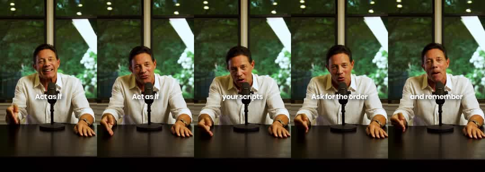

# v09_s24 · aroll_caption · 53.5–58.0s (calidad 2)

- **Guion:** Act as if, prepare your scripts, ask for the order and remember
- **Qué se ve:** 'Act as if, prepare your scripts, ask for the order and remember'
- **Diseño:** Estudio: mesa negra brillante, micrófono de podcast centrado, ventanal con vegetación detrás (no croma). Subtítulos centrados sobre el pecho.
- **Efectos:** Grade cálido-verdoso natural; franja negra inferior en algunos encuadres; sin grano ni viñeta añadida.
- **Animación:** Corte 53.47.
- **Por qué aquí:** Lista rápida de mandatos en cara.
