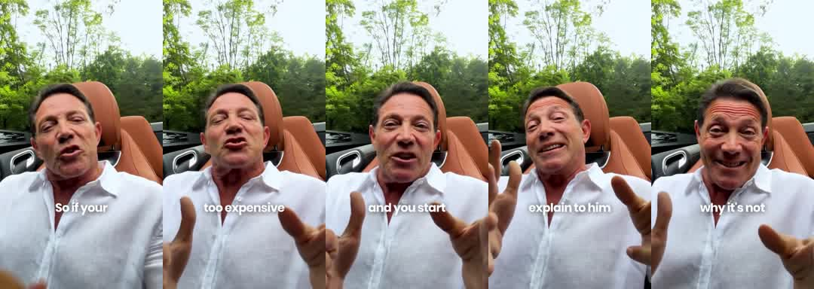

# v10_s01 · aroll_caption · 0.0–4.8s (calidad 3)

- **Guion:** So if your client says it's too expensive and you start trying to explain to them why it's not,
- **Qué se ve:** Selfie en el coche: 'So if your client says it's too expensive and you start trying to explain to him why it's not,' — gesticula con las dos manos.
- **Diseño:** Selfie con el móvil en mano dentro de un descapotable con asientos de cuero coñac, árboles verdes y cielo blanco detrás; cara grande en el tercio superior-medio; manos entran en cuadro al gesticular.
- **Efectos:** Sin texturas; luz de día nublado, cielo casi quemado (#F0F4F6), verdes saturados, cuero naranja; sin grade llamativo, sin viñeta.
- **Animación:** Sin cortes hasta 5.67; subtítulo por frase.
- **Por qué aquí:** Hook-problema (objeción 'es muy caro') que todo vendedor reconoce; sin tarjeta, solo cara.
