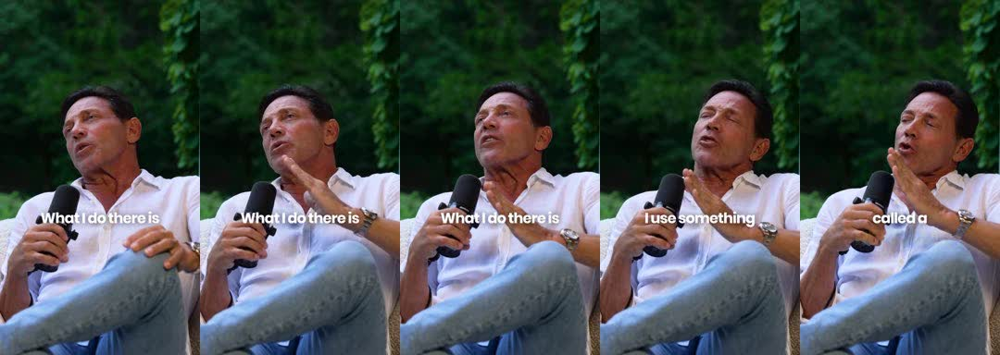

# v11_s03 · aroll_caption · 2.5–4.3s (calidad 3)

- **Guion:** So what I do there is something called a
- **Qué se ve:** [observado 3.0] Jordan plano medio respondiendo, mano en la barbilla. Caption 'What I do there is' → 'I use something' → 'called a'.
- **Diseño:** 1 línea blanca extra-bold ~3.5 % alto, centro y≈61 %.
- **Efectos:** Grado natural, sin textura ni viñeta añadida.
- **Animación:** [observado] Bloques de 2–4 palabras que se sustituyen en seco. [observado 3.6 aprox.] el encuadre se ve algo más cerrado que a 2.4 (posible punch-in digital ~1.1×, inferido).
- **Por qué aquí:** [inferido] Arranca la respuesta: cara + subtítulo base para conectar antes de soltar el concepto.
