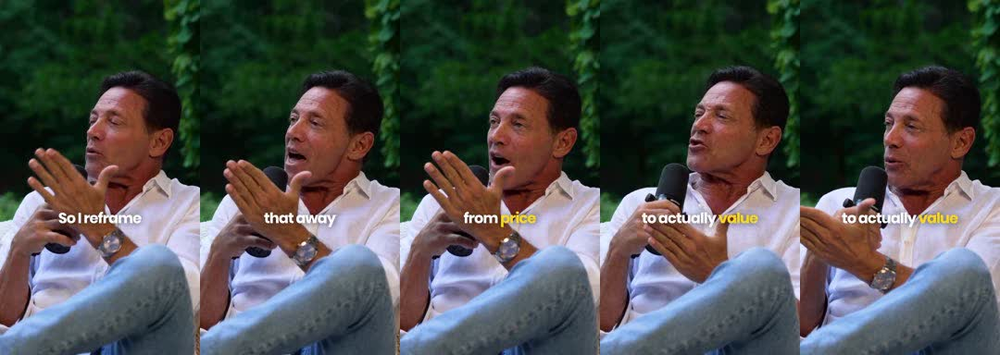

# v11_s13 · aroll_caption · 21.0–25.1s (calidad 3)

- **Guion:** So I reframe that away from price to actually value.
- **Qué se ve:** [observado 21.0–24.5] Jordan cerca (plano más cerrado que antes) frotándose las manos; captions 'So I reframe' / 'that away' / 'from price' (price amarillo) / 'to actually value' (value amarillo).
- **Diseño:** 1 línea; palabra clave en amarillo dentro de la misma línea y al mismo tamaño que el blanco.
- **Efectos:** Ninguno.
- **Animación:** [observado 22.3–22.4] 'price' cambia a amarillo en la línea; bloques secos.
- **Por qué aquí:** [inferido] Contraste price→value marcado solo con color, sin crecer: el énfasis es la oposición de dos palabras.
