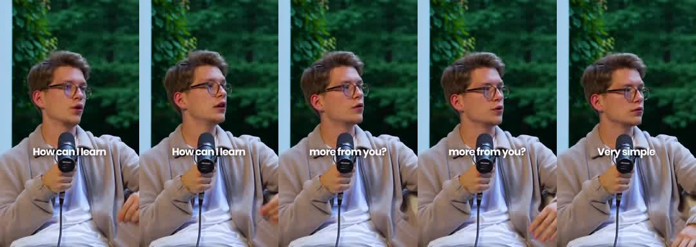

# v11_s21 · aroll_caption · 39.0–40.1s (calidad 3)

- **Guion:** How can I learn more from you?
- **Qué se ve:** [observado 39.0–40.0] Entrevistador pregunta: 'How can I learn' / 'more from you?'.
- **Diseño:** 1 línea blanca ~3.5 % alto.
- **Efectos:** Ninguno.
- **Animación:** Bloques secos.
- **Por qué aquí:** [inferido] CTA disfrazado de pregunta del entrevistador: hace natural el 'follow me'.
