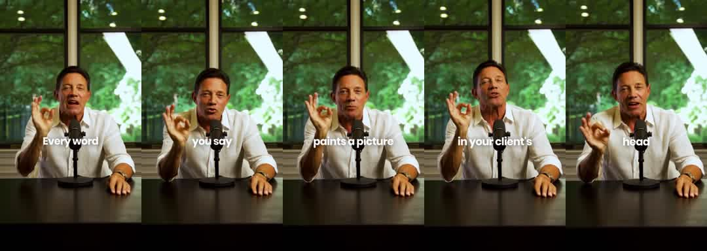

# v12_s12 · aroll_caption · 30.8–34.8s (calidad 3)

- **Guion:** every word you say paints a picture in your client's head
- **Qué se ve:** [observado 31.5–34.4] Jordan haciendo gesto 'OK' con la mano; 'Every word' / 'you say' / 'paints a picture' / 'in your client's' / 'head'.
- **Diseño:** 1 línea blanca minúsculas ~3 % alto.
- **Efectos:** Ninguno.
- **Animación:** [observado 31.03] jump-cut de escala. Bloques secos. [observado 35.0–35.1] el A-roll se funde a negro en ~3 fr.
- **Por qué aquí:** [inferido] Tesis del video en cara antes de ilustrarla con fotos.
